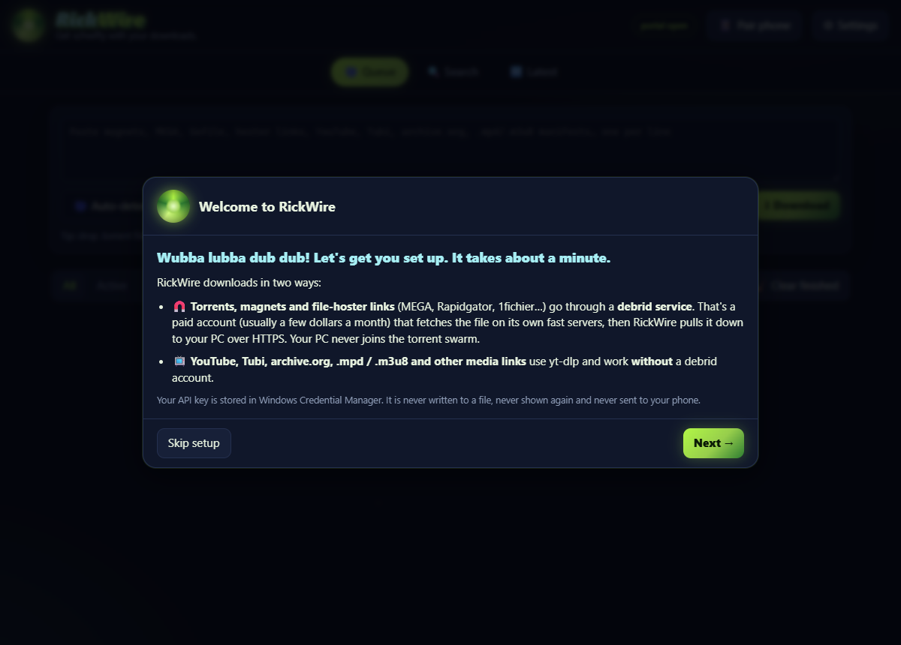
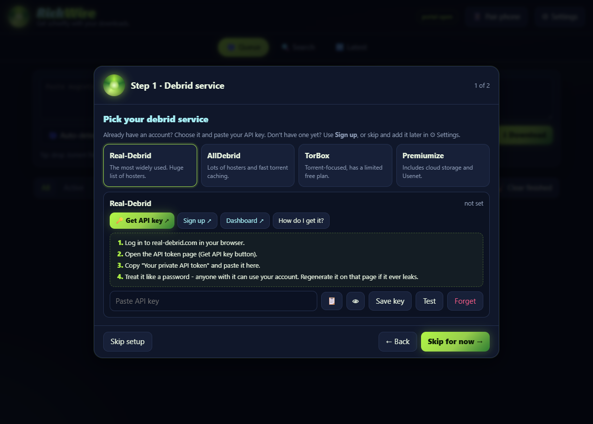
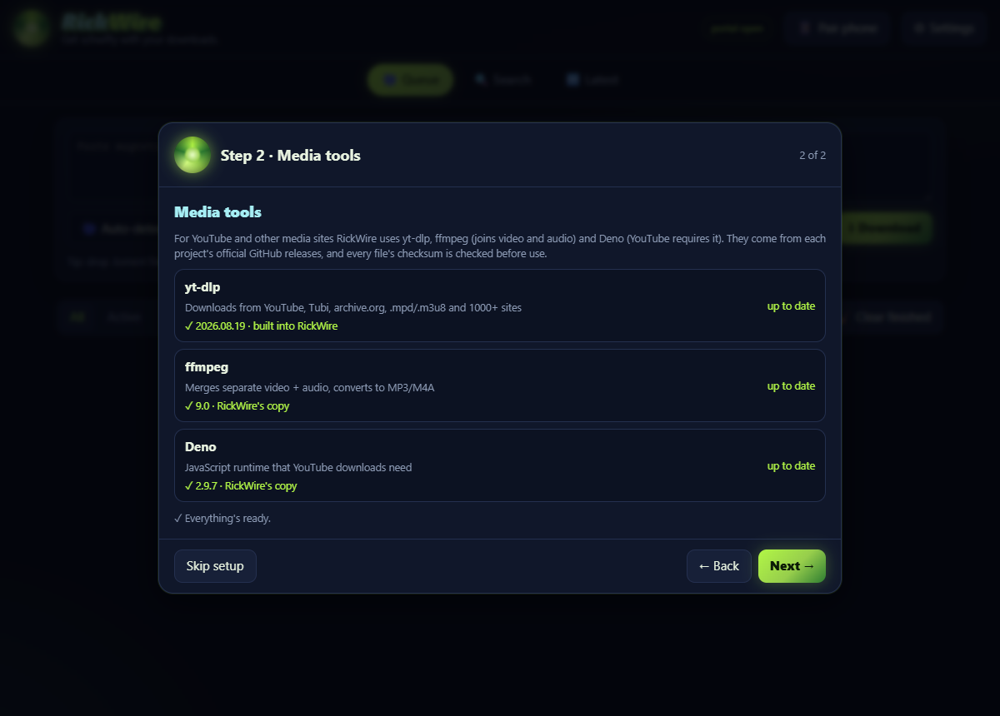
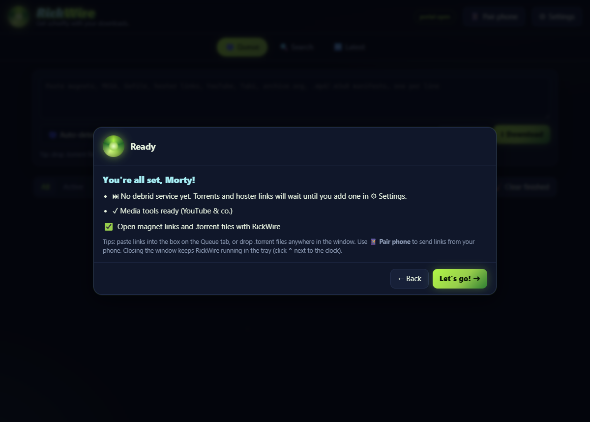
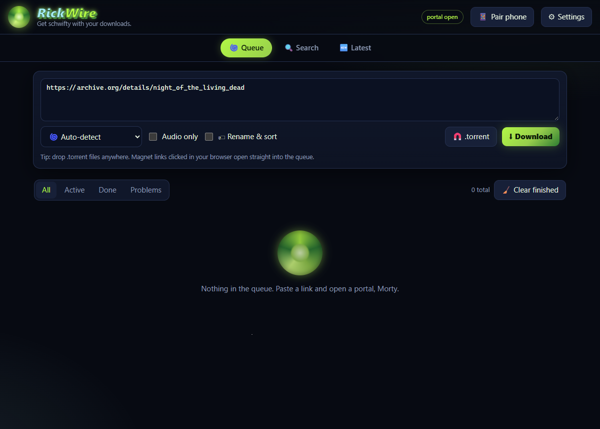
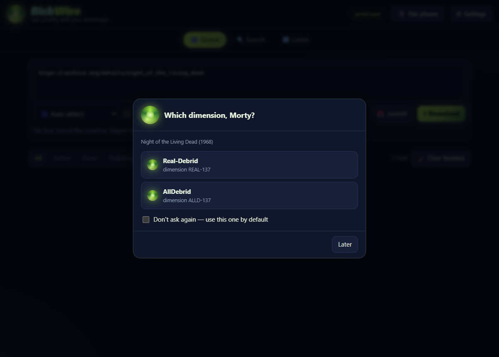
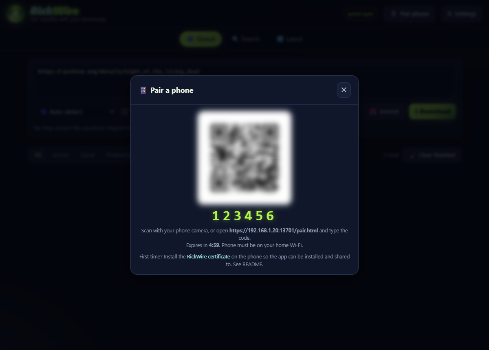
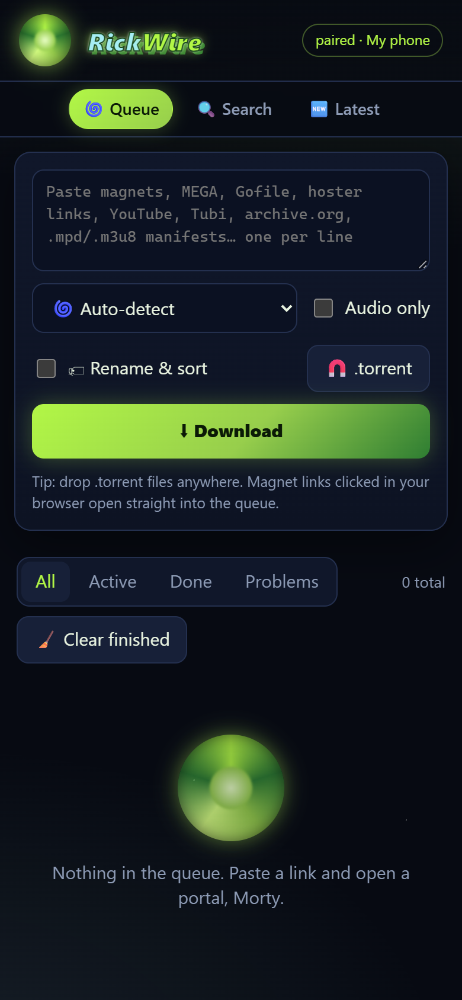
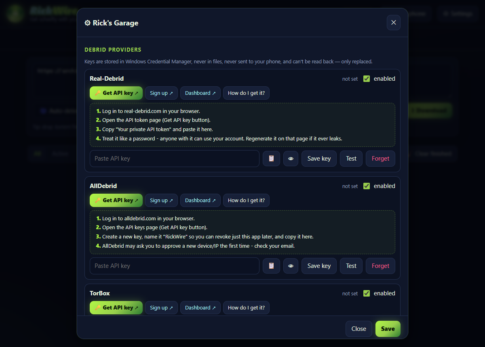
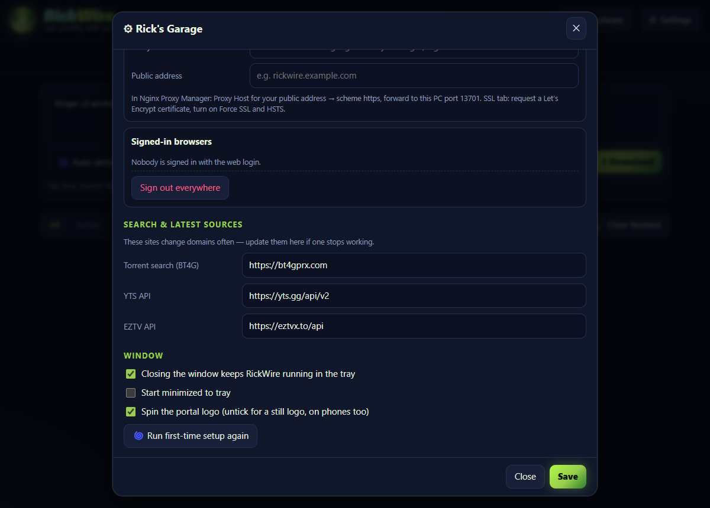

# Getting started with RickWire 🌀

RickWire downloads things for you: movies and shows from torrents, files from sites like MEGA, and videos from
YouTube and many other sites. You paste a link, click **Download**, and the file appears in your Downloads folder.

This guide walks you through it one step at a time. No technical knowledge needed.

---

## What you need

- A Windows PC.
- **For torrents and file-sharing sites:** a *debrid* account. This is a paid service (usually a few dollars a
  month) that grabs the file on its own fast servers and hands it to RickWire. Supported services are
  **Real-Debrid**, **AllDebrid**, **TorBox** and **Premiumize**. If you don't have one yet, RickWire has
  sign-up buttons for each.
- **For YouTube and other video sites:** nothing extra. This works without an account.

---

## 1. Install it

1. Double-click **`RickWire-Setup-<version>.exe`**.
2. If Windows shows a blue **"Windows protected your PC"** box, click **More info**, then **Run anyway**.
   (This happens with apps that aren't from big companies. It's safe.)
3. Click **Next** through the installer and then **Finish**.
4. If Windows asks whether RickWire may use the network, tick **Private networks** and click **Allow**.
   That's what lets your phone talk to it later.

> **No installer?** If someone gave you the portable folder instead, just open it and double-click
> **`RickWire.exe`**.

---

## 2. The first-time setup

The first time RickWire opens, a short setup appears.

**Welcome:** a quick explanation. Click **Next**.

**Step 1, pick your debrid service:** click the service you use. The green **🔑 Get API key** button opens the
right page on that service's website, and the steps underneath tell you exactly what to copy.

1. Click **🔑 Get API key** and log in on the website that opens.
2. Copy the key (a long string of letters and numbers).
3. Back in RickWire, click into **Paste API key**, paste it, and click **Save key**, then **Test**.
   You should see a green tick.

> 🔒 **Your key is safe.** RickWire keeps it in Windows' own password vault (Credential Manager). It's never
> saved in a file, never shown again, and never sent to your phone. Treat the key like a password and don't
> share it.

No account yet? Click **Sign up**, or click **Skip for now**. You can add it later in ⚙ **Settings**.

**Step 2, media tools:** these are the helpers for YouTube and other video sites. If anything says *missing*,
click **⬇ Download what's missing** and wait for the ticks. Then click **Next**.

**All set:** leave **"Open magnet links and .torrent files with RickWire"** ticked so that clicking a torrent link
in your browser sends it straight to RickWire. Click **Let's go!**

---

## 3. Download something

1. Copy a link: a YouTube video, a magnet link, a MEGA link, and so on.
2. Paste it into the big box on the **🌀 Queue** tab. You can paste several, one per line.
3. Click **⬇ Download**.

The download shows up below the box with a progress bar. When it's finished it says **Completed**, and you get a
"Wubba lubba dub dub!" notification.

Other ways to add things:
- **Click a magnet link** in your web browser. It goes straight into RickWire (the first time, your browser may
  ask whether to open RickWire; say yes).
- **Double-click a `.torrent` file**, or drag it onto the RickWire window.

**Useful options next to the Download button:**
- **Audio only:** for music or podcasts from YouTube and similar sites. You get an MP3 instead of a video.
- **🏷 Rename & sort:** tidies finished movies into `Movies\Title (Year)` and shows into
  `TV\Show\Season 01` folders. Handy if you use Plex or a similar media player.

### If RickWire asks "Which dimension, Morty?"

If you've set up **more than one** debrid service, RickWire asks which one to use for each torrent. Click one.
Tick **"Don't ask again"** if you always want the same one.

You can answer this on your PC or your phone. Answering on one closes the question on the other.

### If RickWire asks you to pick files

Some torrents contain many files (a whole TV season, or extras). RickWire lets you tick only the ones you want.
**Videos only** is a quick way to skip the extras.

### Finding your files

- Click **📂** on a finished download to open its folder.
- Unless you changed it, everything goes to **Downloads › RickWire**.

### When something goes wrong

- A download that failed shows a **↻** button. Click it to try again. RickWire also retries on its own a few
  times when the internet drops.
- **✕** removes a download from the list (it asks whether to delete the file too).

---

## 4. Send downloads from your phone

You can paste links on your phone, or use your phone's **Share** button, and the PC downloads them.

**On the PC:** click **📱 Pair phone** at the top. A QR code appears.

**On the phone:**
1. Make sure the phone is on your **home Wi-Fi**.
2. Open the camera and point it at the QR code. Tap the link that appears.
3. The phone opens RickWire and is paired automatically.

**Make it an app on your phone (one-time, Android):**
1. On the pairing page, tap the **RickWire certificate** link to download it.
2. Go to *Settings › Security › Encryption & credentials › Install a certificate › CA certificate* and pick the
   file you just downloaded.
3. Open RickWire in Chrome again, tap **⋮** and then **Install app**.
4. Now **Share › RickWire** appears when you share a link from YouTube or your browser.

The phone can add and manage downloads, search, and browse *Latest*. It can never see your API keys or change
settings.

> **Using RickWire away from home?** That's an optional, more advanced setup (it needs a reverse proxy such as
> Nginx Proxy Manager). See *Remote access* in the main [README](../README.md). Once it's on, the pairing QR
> code works from anywhere.

---

## 5. Search and Latest

- **🔍 Search:** type a name to find torrents. Click **➕** on a result to download it.
  **⚡ Check cache** shows which results your debrid service already has, so they download instantly.
- **🆕 Latest:** new movie and TV releases. Click a quality button (like **1080p**) to download.

---

## 6. Settings worth knowing

Open ⚙ **Settings** (top right).

- **Debrid providers:** add, test or remove your API keys.
- **Downloads:** change where files are saved and how many download at once.
- **Window:**
  - *Closing the window keeps RickWire running in the tray.* This is on by default so your phone can still send
    it downloads. To really quit, right-click the round RickWire icon near the clock and choose **Quit**.
  - *Start minimized to tray.*
  - *Spin the portal logo.* Untick it if the spinning green logo bothers you. It stops on your phone too.
  - *Run first-time setup again.*

Click **Save** when you're done.

---

## Updating

Run the newer **`RickWire-Setup-<version>.exe`**. It closes RickWire, updates it, and keeps all your settings,
keys, paired phones and download list.

---

## Common questions

**Nothing happens when I click a magnet link.**
Open ⚙ Settings › *Magnet & .torrent handler* and click **Register RickWire**. If another torrent app still
grabs links, click **Windows Default apps…** there and choose RickWire.

**My phone says it can't connect.**
Make sure the phone is on the same Wi-Fi as the PC and that RickWire is running (look for the round icon near the
clock). If Windows asked about network access when you first ran RickWire and you clicked *Cancel*: open the Start
menu, search **Allow an app through Windows Firewall**, click **Change settings**, find **RickWire** and tick
**Private**. Also check that your home Wi-Fi is set to *Private network* in Windows' Wi-Fi settings.

**Torrents just sit there waiting.**
You probably haven't added a debrid key yet. Add one in ⚙ Settings › *Debrid providers*.

**A YouTube download fails.**
Open ⚙ Settings › *Media tools* and click **Update** on yt-dlp, then restart RickWire. Video sites change often
and the tool needs to keep up. RickWire updates it by itself once a day.
